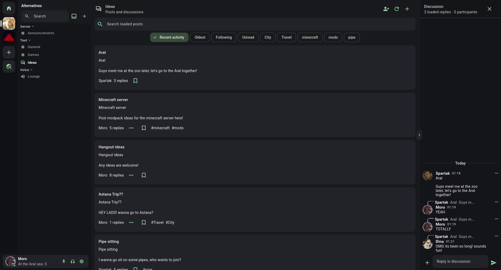
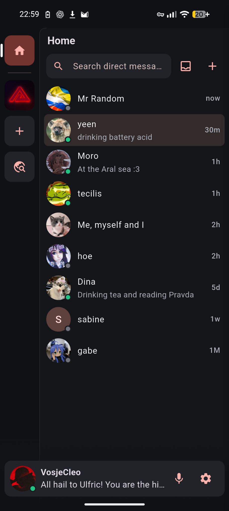
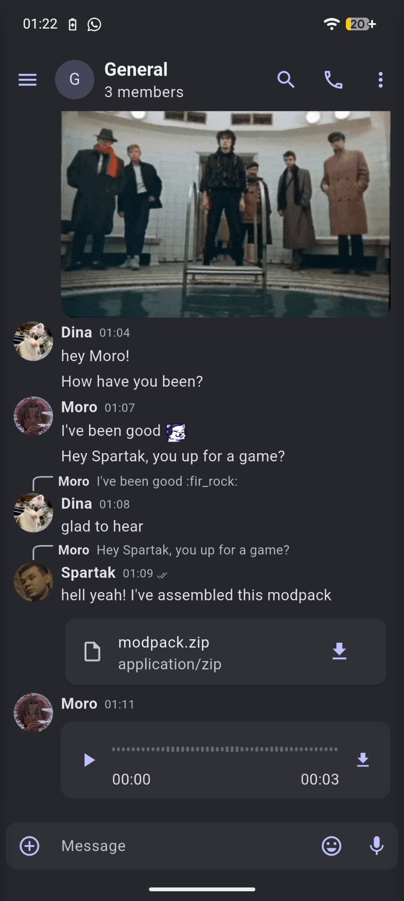
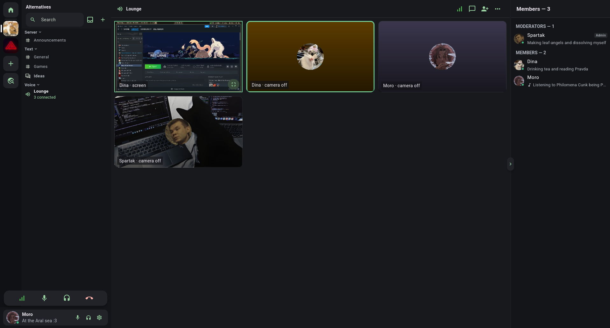
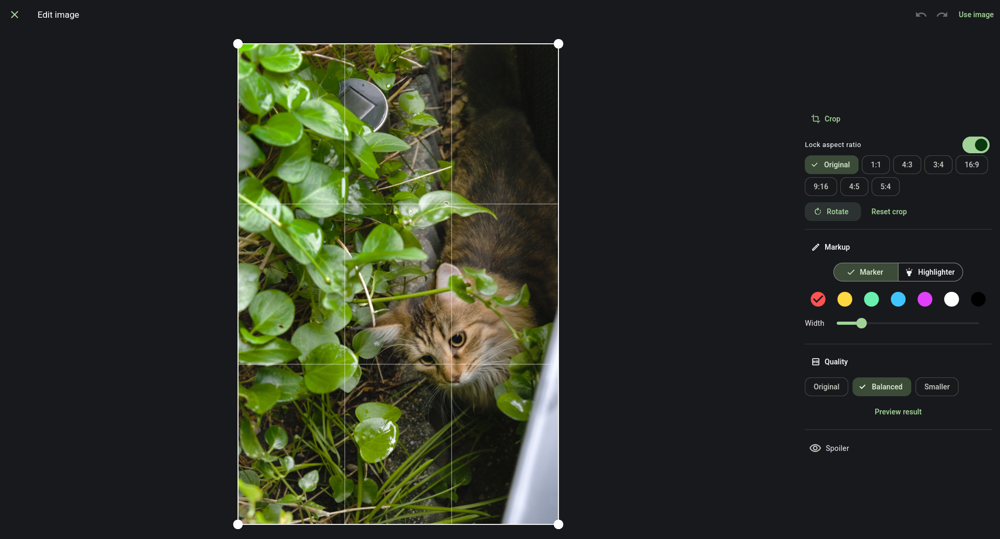
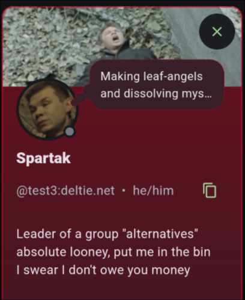
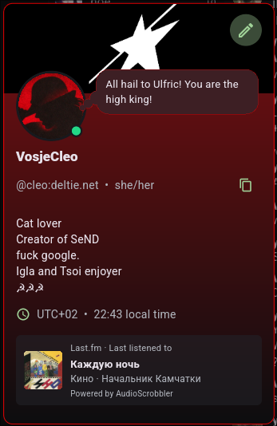
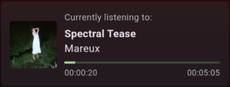
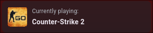

# SeND

An open-source Matrix messenger with familiar servers, channels, calls and profiles.
Linux, Windows, Android, and the web, including iPhone/iPad as an installed PWA.

**Latest: version 0.9.42 build 134.** Stable promotion follows further testing.

[Download SeND](https://deltie.net/SeND/) · [Open the web app](https://chat.deltie.net) ·
[Installation](INSTALL.md) · [Changelog](CHANGELOG.md) · [Documentation](docs/README.md)

SeND stands for **“SeND is Not Discord”**, a recursive acronym. It was previously
called Deltiecord. It connects to ordinary Matrix homeservers, so you can talk to
people using Element, FluffyChat and other Matrix clients too.

The aim is simple: bring the familiar UX of Discord to an open, self-hostable
network, with end-to-end encryption and no subscription-gated profile cosmetics.

## Chat on your phone, too

  
  

Native Android has its own phone layout. The web app uses that layout on phones
and the desktop layout on larger screens. On iPhone/iPad, open
[chat.deltie.net](https://chat.deltie.net) in Safari and choose **Share → Add to Home Screen**.
No App Store or TestFlight installation is needed.

More pictures are in the [screenshot gallery](docs/screenshots.md). These supplied
captures include earlier interface revisions; they are not all from build 134.

## What it does

- **Messaging:** encrypted DMs and group chats, replies, mentions, reactions,
  spoilers, edits, polls, pinned messages, drafts, saved messages and local
  scheduled sends.
- **Communities:** Matrix Spaces presented as servers, with text and voice
  channels, categories, forums, threads, roles and moderation controls.
- **Calls:** MatrixRTC voice, video and screen sharing, speaking indicators,
  participant volume controls, mute and deafen. Desktop-audio sharing depends
  on the operating system and capture support.
- **Expressions:** custom emoji and sticker packs, Telegram/ZIP imports, pack
  editing, favourites, usage-ranked autocomplete and KLIPY GIF search.
- **Media:** inline playback, link previews, spoilers, collages, fullscreen
  viewing, voice messages, and photo/video editing before sending.
- **Search:** optional local text indexing, exact-phrase searches, sender/date
  filters, paged results, media/file/link galleries and history downloads.
  Automatic gap recovery catches up after a device has been offline.
- **Profiles:** banners, colours, gradients, thought-bubble statuses, pronouns,
  timezones and per-server profiles.
- **Activity:** opt-in desktop game/program detection, Discord IPC and music
  activity. Last.fm or Libre.fm can show listening activity and a persistent
  last-listened track. Activities are viewable on every platform.
- **Personal organisation:** pinned and archived chats, reordered Spaces and
  folders in the Space bar.
- **Settings:** appearance and accessibility controls, JSON themes and custom
  icon packs, notification controls, compression presets and local/server
  storage controls. Deltie accounts currently get a 12 GiB upload allowance.

SeND uses Matrix rooms and Spaces, not a separate chat network. Other clients may
ignore SeND's profile, category or presentation fields. Roles use Matrix power
levels, and threads share their parent room's access. Scheduled sends need the
client to stay connected. Server storage controls need the optional homeserver
module; they are not a standard Matrix quota API.

## Calls and screen sharing

Keep a channel's text chat open beside the call, or open a shared screen fullscreen.
Calls use MatrixRTC with an SFU; self-hosters need the corresponding RTC services.
See the [server setup guide](server/INSTALL.md).

## Edit before sending

Crop, rotate and mark up images. Trim, crop, rotate or mute video, then choose
upload quality and whether to hide it behind a spoiler. The 64 MiB attachment
batch limit is checked **after compression**, when you send.

Browser video editing and compression use WebCodecs where supported. Available
codecs and export limits vary by browser.

## Make it yours

  
  

Profiles and cosmetics are not paid extras. Desktop activity detection and
listening history are optional, with separate sharing controls.

## Privacy and account safety

SeND has no intentional analytics or user tracking. It uses the Matrix SDK and
established cryptographic libraries, not custom message encryption.

Keep your **recovery key** somewhere safe. Clearing app data, browser site data
or a private browsing session can remove local encryption keys. Device
verification and recovery are separate from password or SSO/OIDC sign-in.

Local text indexing is optional. Local Matrix databases and search indexes are
encrypted on Android, desktop and the PWA. Native keys use OS-protected storage;
the PWA unlocks automatically with browser-held keys. This cannot protect against
compromised site code or a copied browser profile. Media indexing stores event references,
not an offline copy of every attachment. Search cache limits are configurable;
bulk downloads pause and offer a larger limit when full.

Your homeserver, federation and RTC infrastructure handle normal Matrix traffic.
GIF search uses SeND's KLIPY proxy. Last.fm and Libre.fm are contacted when you
enable those integrations. Link previews normally use the homeserver or the
supported preview bridge; the optional direct fallback is off by default.
Opening links contacts the linked site. A SOCKS proxy can cover supported native
requests, but calls and other unsupported traffic may still connect directly.

See [Networking and privacy](docs/networking.md) for details and
[known issues](KNOWN_ISSUES.md) for platform and protocol limits.

## Notifications and the web app

Native Android offers SeND's built-in notification service or UnifiedPush.
The built-in service needs background/battery permission. UnifiedPush needs a
compatible distributor and gateway.

On iPhone/iPad, Web Push needs **iOS/iPadOS 16.4+**, a Home Screen installation
and notification permission. A normal Safari tab is not enough. Notification
delivery and background decryption remain subject to browser/OS limits.

The browser stores sessions and crypto state in IndexedDB. Keep your recovery
key, avoid opening the same session in multiple tabs, and do not rely on private
browsing for a persistent session. Browser playback and compression also depend
on available codecs.

For hosting, see [Web deployment](docs/web-deployment.md), including its HTTPS,
cross-origin isolation and SSO callback requirements.

## A note from Cleo

Yes: a large part of the source code for this project was generated by a mixture of locally run LLMs.

Think of that what you want.

I am not a programmer, and I did not want becoming one to be a prerequisite for making the software I wanted. SeND started because I was unhappy with the state of Discord  (particularly its lack of end-to-end encryption) and because the existing alternatives never quite offered the combination of features, usability and interface that I was looking for.

So I decided to ask my poor GPU to make me one.

The project has since gone through a rather unreasonable number of builds, rewrites, bug fixes, UI passes, regression tests and architectural cleanups. I have been directing the design, testing it in actual use, breaking it repeatedly, and making Qwen fix the resulting mess.

I want to give the result back to the community.

Please forgive my sins of vibecoding.

## Platforms and testing

Packages are available for **Linux, Windows and Android**, plus the **web/PWA**.
Linux packages include AppImage, Flatpak, Arch and Debian/Ubuntu formats.
There are no published native macOS or iOS packages; Apple users can use the web app.

Native Linux, Windows and Android get the most daily use. All supported platforms
have had extensive hands-on testing, including PWA and iOS PWA, though those get
less frequent use. Expect occasional bugs. No slow memory leaks have been
reported over many hundreds of cumulative usage hours. Cleo's populated account
idles around 450 MB; usage varies with platform, account and open media.

0.9.42 build 134 is published to **Latest**. Stable promotion waits for further testing.
Work toward 1.0 continues on performance, accessibility,
interoperability and reliability. See the [1.0 readiness checklist](docs/RELEASE_READINESS.md).

## Bugs and contributions

Check [KNOWN_ISSUES.md](KNOWN_ISSUES.md), then report your version/build, platform
and reproduction steps. Bug reports with reproduction steps are extremely useful.

"scroll weird" is somewhat less useful.

Issues, testing, documentation improvements and pull requests are welcome.
Criticise this project as much as you wish! All actual human input is very very welcome.

Please preserve Matrix interoperability, encryption behaviour, privacy
expectations and the compact interface. Use standard Matrix representations
where possible.

Because much of the existing project was AI-assisted, contributions do not need to conform to some ideological standard of hand-written purity.

They do, however, need to work.

## Credits and licence

SeND would not exist without the Matrix ecosystem and the open-source projects it builds upon.

See [CREDITS.md](CREDITS.md), [LICENSE](LICENSE) and
[THIRD-PARTY-NOTICES.md](THIRD-PARTY-NOTICES.md). SeND is licensed under
**AGPL-3.0-or-later**. Screenshot artwork belongs to its respective creators.

**Documentation baseline: 0.9.42+134.** Technical guides and older engineering
records are in the [documentation index](docs/README.md).
