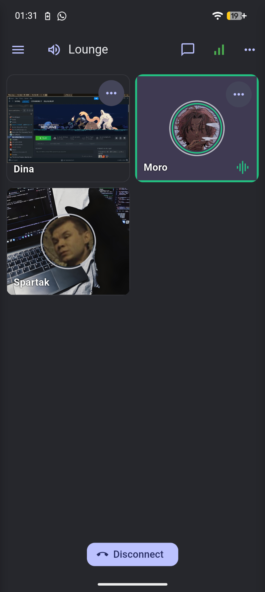
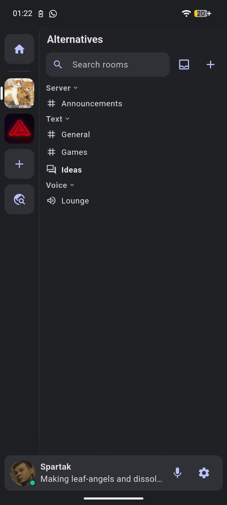

# SeND screenshot gallery

Selected from Cleo's supplied desktop, Android and activity captures. Some show
earlier interface revisions; these are not all build 134 screenshots. The images
are unmodified. Names and conversations are visible as supplied.

## Forums and discussions

## Calls and screen sharing

## Image editing

## Android

  
  
  

## Profiles and listening history

  
  

## Activity details

Game detection runs on native desktop clients. Activities can be viewed on other
platforms. Last.fm and Libre.fm sharing are optional.

## Captures still wanted

- A populated desktop conversation, with a profile or thread open beside it.
- Current search results, including the sender filter and page controls.
- The mobile image editor with markup, plus the video trim/crop controls.
- The emoji/sticker picker and pack editing, consolidation or splitting.
- Server storage usage and pruning preview, with no private file details.
- An iPhone Home Screen PWA capture, and a light-theme example.

Keep credentials, recovery keys, notification contents and unrelated windows out
of captures. Use showcase rooms and people who are happy to appear in public.
Do not ring other people or change shared production permissions just to get a
screenshot. Artwork in screenshots belongs to its respective creators.

The older build 115 captures remain in this directory for historical links.
They are no longer presented as the current gallery.
